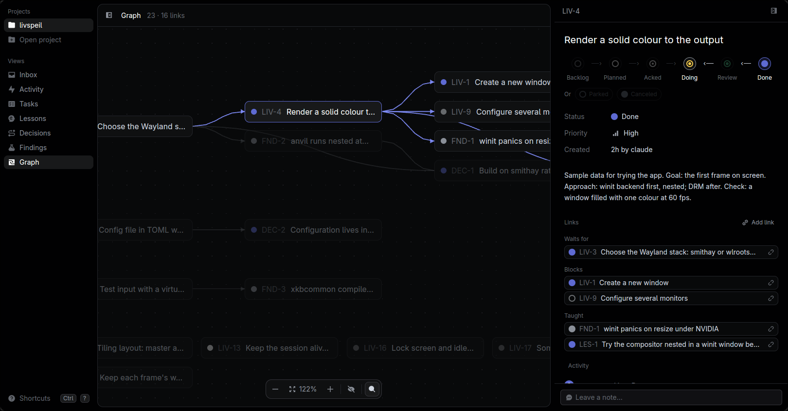

# livtk



Durable tasks and memory for Claude Code and its human. Local only: no API, no server, no keys.

Claude plans work and moves it along; the human acknowledges each plan before it starts. Every
change is an event in `.livtk/events.jsonl`, committed with the project, so history survives
sessions, crashes and git branches. A SQLite database next to it answers queries fast and can
always be rebuilt from the log.

The design is in [docs/plan.md](docs/plan.md).

## Install

livtk, then the Claude Code plugin (hooks, skills, agents) from this repository. On macOS one app
bundle holds the app and the `livtk` command, so one update covers both:

```
scripts/check --install      # macOS: ~/Applications/livtk.app, and livtk, livtk-app linked into
                             # ~/.local/bin (it says if that is not on PATH, or an older copy
                             # comes first); elsewhere: cargo install of both binaries
claude plugin marketplace add /path/to/this/repo     # or: /plugin marketplace add nebulaw/tasks
claude plugin install livtk@livtk                    # or: /plugin install livtk --marketplace nebulaw/tasks
```

### Updates

The app looks for a newer build when it starts, every 6 hours, and from livtk ▸ Check for
Updates…. It stages one in the background (checking its size, SHA-256 and that it is the build
its manifest names) and then offers **Restart to Update** in the livtk menu and the sidebar,
never on its own. On it the app quits, a small helper inside the bundle (`livtk-update`) swaps
the installed app for the new one and starts it; if the new build does not start, the old one
comes back. Updates come from a local folder for now
(`~/Library/Application Support/livtk/updates`), filled by:

```
scripts/release [--quick] ["what changed"]   # commit first: a release is numbered by its commit
```

The plugin is silent in any project without a `.livtk/` directory, so it can stay enabled
everywhere. Its hooks only do what livtk alone knows: brief Claude at session start and before a
prompt, guard the human's commands and `.livtk/`, and refuse the implementer's stop while a task
in progress has nothing recorded about it. **Formatting and build checks are not livtk's:** run
your formatter from your own `PostToolUse` hook and your check from your own `SubagentStop` or
`Stop` hook (see Claude Code's hooks documentation). A `[hooks] format` or `check` left in
`.livtk/config.toml` is ignored with a warning, and becomes an error in the next release.

**A project with hooks of its own.** Claude Code runs every hook registered for an event, so a
project that already briefs Claude at session start gets two overlapping blocks. Two ways out:

- Keep the plugin, and tell livtk what to leave out, in `.livtk/config.toml`:

  ```toml
  [hooks]
  disable = ["session-start"]          # or user-prompt-submit, subagent-start, subagent-stop

  [session_start]
  include = ["tasks", "gates"]         # of intro, tasks, projects, gates, protocol, rules

  [user_prompt_submit]
  include = ["memory"]                 # of memory (what is recalled), nudge (propose a lesson)
  ```

  Nothing set, everything is said, as before. A name livtk does not know stops it with an error
  naming it, so a typo never switches something off quietly. The guard on the human's commands
  cannot be switched off.

- Or skip the plugin and call livtk from your own hook: `livtk hook <event>` reads the hook's
  JSON on stdin and answers in Claude Code's own shape, so one hook per event says both:

  ```bash
  #!/usr/bin/env bash
  # .claude/hooks/session-start.sh: your project's own context, then livtk's, as one block.
  input=$(cat)
  ours="Branch: $(git branch --show-current 2>/dev/null)"
  theirs=$(printf '%s' "$input" | livtk hook session-start | jq -r '.hookSpecificOutput.additionalContext // empty')
  jq -n --arg c "$ours"$'\n'"$theirs" \
    '{hookSpecificOutput: {hookEventName: "SessionStart", additionalContext: $c}}'
  ```

**A project's own kinds and relations.** livtk ships five kinds (task, lesson, decision,
finding, project) and five relations (waits for, relates, supersedes, learned from, part of). A project
that needs its own words declares them in `.livtk/config.toml`; one that declares nothing gets
exactly the built-in set.

```toml
[[kinds]]
name   = "incident"
states = ["open", "mitigated", "closed"]   # in order; it starts at the first unless `start`
closed = ["closed"]                        # what counts as over (the last state unless given)
human  = ["mitigated -> closed"]           # moves only you may make
key    = "INC"                             # its keys: INC-1, INC-2
memory = false                             # true: recalled like lessons and findings

[[relations]]
name    = "implements"
inverse = "implemented_by"                 # how it reads from the other end
```

A declared kind moves between any two of its states, is created with `livtk new --kind incident`,
listed with `livtk list --kind incident`, gated by `[gates]` like any other, found by search, and
has its own view in the app with its states as groups and board columns. A declared relation is
linked with `livtk link A implements B` (or `livtk link B implemented_by A`) and shows from both
ends. A kind cannot be taken out of the config while nodes of it exist: livtk stops and names
them. A name livtk already uses is refused.

Other optional per-project settings in `.livtk/config.toml`:

```toml
[gates]
human = ["task: review -> done", "task: -> canceled"]  # more moves only you may make
```

Acknowledging a plan and deciding what binds (ratifying, accepting, rejecting, retiring) are
always yours. `[gates]` can only add to them: the file is in the repository, where Claude could
change it, so an edit to it can make Claude stricter, never freer. An entry is `kind: from ->
to`, or `kind: -> to` from any state; one that names no legal move stops livtk with an error.
What waits on a gate from a state shows in your inbox, and the app marks such moves as your
decisions.

## Use

```
livtk init                          # once per project: creates .livtk/, commit it
livtk new "Draw the first window" -p 2
livtk new "Simple compositor" --after LIV-1 --body - < plan.md
livtk new "Damage tracking" --parent LIV-2   # a sub-task
livtk link 3 relates 1              # also waits-for, blocks, learned-from, supersedes,
                                    # part-of, has-part; `livtk unlink` takes the same words
livtk list                          # open tasks by state (aliases: ls, board)
livtk move 1 planned                # Claude proposes the plan
livtk ack 1                         # you acknowledge it (human only)
livtk next                          # the best task to start now
livtk start 1                       # refused while a dependency is open
livtk move 1 review
livtk done 1
livtk note 1 "winit panics on resize; trying the drm path"
livtk show 1                        # links, docs, body, notes, history
livtk log                           # every event in the project
livtk doc list                      # the docs (markdown under docs/), with their links
livtk doc link 1 docs/guide.md      # link a node to a doc; any number each way
livtk doc links 1                   # a node's docs; `livtk doc links docs/guide.md`, a doc's nodes
```

Docs are the project's markdown files, under `docs/` (or the folder `docs = "..."` in
`.livtk/config.toml` names); linked to nodes through the log, by their path.

Keys accept `LIV-12`, `liv-12` or just `12`. Every command takes `--json`.

**Projects: an outcome above tasks.** A project (`PRJ-1`) says what should be true, its body
ending in a `Done when:` line. Claude may propose one; only you commit to it (`livtk move PRJ-1
active`) and call it done. Tasks join it as parts (`livtk new "..." --parent PRJ-1`, or `livtk
link 3 part-of PRJ-1`), and projects nest the same way; a node has one parent, so it counts
toward one project. Its progress is counted, never typed in: tasks done out of all of them
(canceled ones aside), and what waits on you (planned for your ack, in review for your check, and
whatever your gates hold), with the one waiting longest. Its health is written: an update says on track, at
risk or off track, what moved and what is next; an active project a week without one reads
"update missing".

```
livtk project new "Import the board" --body - --target 2026-12-01 --owner karl < outcome.md
livtk project list                  # active first: state, done/total, health, what waits on you
livtk project show PRJ-1            # its outcome, parts, waits and newest update
livtk project update PRJ-1 --health at_risk "parsing is slow; next: batch it"
livtk project set PRJ-1 --target "" # an empty value clears it
```

**Flow, measured.** `livtk flow` reads the log for how long tasks spend in each state (the
median per task, and all together), what waits on you now and the longest wait, and with
`--project PRJ-1` that project's tasks alone and its lead time, from its first task started to
done. The app shows the waits above the activity feed, and a project's in its panel.

More than three active at once, and `project list` says so: fewer at a time finish sooner. Lists
name a task's project (`[PRJ-1]`, and `"project"` in `--json` rows) once there is one. Project
events are format 6: an older livtk skips them and asks to be updated.

**For scripts.** `livtk list --json` gives small rows; `--fields key,state,props` picks what each
row carries, a node's own `body`, `props`, `created` and `created_by` included. `livtk show KEY
--json` gives everything about one node: its fields with body and props, its links, its notes and
its history.

**A markdown mirror, if you want one.** `livtk export` writes every node as a markdown file
(fields as frontmatter, then the body, the links and the notes) into `.livtk/export`, which keeps
itself out of git; `--dir` writes elsewhere, and `--check` fails if the folder is behind the log,
for CI. **It is a copy, never read back: editing an exported file changes nothing in livtk.** The
log is the truth, and an export is whatever this machine can read of it, wherever the log lives.

### Signals

Agents and tools hear what happens as signals, one JSON object per line, derived from the log:
`node.created`, `node.moved`, `node.edited`, `node.noted`, `link.added`, `link.removed`,
`doc.linked`, `doc.unlinked`, and the
ones worth waking for: `decision.needed` (something waits for you), `decision.made` (you
acknowledged, ratified, accepted, rejected or retired) and `work.unblocked` (the last thing a task
waited for is done). Each names its event; keep the last one you saw and read on from it:

```
livtk events                                        # every signal so far
livtk events --since <event> --follow               # what comes after, as it comes
livtk events --follow --signal decision.made --node 12
```

Signals are versioned (`"v": 1`): fields are only ever added, and a reader ignores the ones it
does not know. Act on a signal's `node` (its id never changes); its `key` is the node's key as it
stands when read, which a merge can still renumber. `--follow` also prints what a git pull merges
in, older events included.

A project can also run a command on a signal, in `.livtk/config.toml`:

```toml
[[on]]
signal = "decision.made"            # and optionally: kind = "task"
run = ["./scripts/wake-agent"]      # the signal's JSON on stdin, run from the project's folder
```

Hooks run after the change is in the log, apart from whatever made it (the CLI starts them on
their own and returns; the app runs them off its window), so a hook never holds up or undoes a
write. Each hook keeps its place (`.livtk/on-state.json`, local to the machine): a failing one is
tried again on the next write, in order, missing nothing, and an event merged in from elsewhere
within 30 days is heard too; a new one hears what comes, not the project's history. A hook's
command runs with `LIVTK_HOOK` set: `livtk` run inside it acts as `claude:hook` (never as you, so
it passes none of your gates), and no hook hears what a hook did, so hooks never wake each other
in a loop. `livtk dispatch` runs them by hand.

## Memory

Claude proposes what it learns; you decide what binds it.

```
livtk lesson "Run cargo check before reporting a task done" --why "a broken build was reported done"
livtk decision "SQLite for local tools" --body "one file, no daemon"
livtk finding "winit panics on resize under NVIDIA" --body "seen with driver 580"
livtk inbox                          # everything waiting for you
livtk ratify LES-1                   # a rule, recalled when relevant (human only)
livtk ratify LES-1 --always          # a standing rule, shown at every session start
livtk accept DEC-1                   # human only; reject and retire too
livtk recall "is the task done?"     # what a prompt would bring back
livtk search "resize"                # every node, by keywords and meaning
livtk embed setup                    # once: the local model (128 MB) for ranking by meaning
```

Lessons, decisions and findings have their own keys (`LES-1`, `DEC-1`, `FND-1`). Editing a
ratified lesson or an accepted decision sends it back for approval, as with tasks. With the
plugin, each prompt carries at most three relevant rules, decisions or findings, and a prompt
that reads like a correction nudges Claude to propose a lesson. Without the model, search and
recall use keywords only. With it, a prompt costs about 5 ms: livtk reads only the rows of the
model the prompt needs, and keeps a sorted copy of its vocabulary (`livtk-vocab.txt`) beside it.

States: `backlog → planned → acked → doing → review → done`, plus `parked` and `canceled`.
Only a human can acknowledge (`planned → acked`). Editing a task's plan once it is acknowledged
(`acked`, `doing` or `review`) sends it back to `planned`, to be acknowledged again. A command run by Claude Code (which sets `CLAUDECODE=1`) acts as Claude; anything else
acts as the human. Refusals by a rule exit with code 3.

## The app

```
livtk-app                    # every project `livtk init` registered
livtk-app ~/code/project     # open one (and remember it)
livtk-app --version          # which build: "0.4.0 (build 87, abc1234)"
livtk-app --install-cli      # macOS: link livtk and livtk-app into ~/.local/bin again
```

The app tells you with a system notification when something new waits in your inbox while its
window is away: a plan to acknowledge, a lesson to ratify, a decision to accept. A click on it
opens the inbox there. macOS posts notifications only for an app bundle: `livtk-app` on PATH is a
link into `livtk.app`, so from a shell it opens the app with the same projects and livtk's own
variables (`LIVTK_*`, `XDG_*`), and returns (if it runs already, it comes to the front, and
projects given show in it after a restart). Any other `livtk-app`, a development build say, runs
as itself, and says once that it posts no notifications from there. Every build knows which it
is (`--version`, and `CFBundleVersion` in the bundle). What the app does is logged in
`~/Library/Logs/livtk/livtk-app.log` (elsewhere `app.log` in livtk's config directory).

The human's control surface: an Inbox of everything waiting for you, an Activity feed of every
change newest first (its badge counts what Claude did since you last looked), a Graph of every
node and link where work flows left to right along its dependencies, tasks as a list or a board,
lessons, decisions and findings, and a detail panel with the plan, its links and its activity.
Changes from Claude show up while it is open, and flash once. It wears Linear's darkest palette
and Boxicons' filled icons; nothing changes the cursor or grows on hover.
A dock floats at the bottom of the content with what the view can do: New task, Filter (`/`,
by title, key, priority or state), Grouping (state, priority), Ordering (priority, last update,
creation), View options (for tasks List or Board, then show empty groups, so every state or
priority has its band in a list and its column on the board, and show dismissed work), the
graph's zoom and its dismissed work, and the command palette.
Its menus open upwards; on a narrow window it shows icons alone. The top bar holds only the view's
name and count. Groups are solid bands that collapse on a click.
On macOS it is a Mac app: a menu bar of the app's own commands (livtk, File, Edit, View, Task,
Window, Help; what is on is ticked; Task's items act on the selected node, as its keys do, and are
greyed while a field has the keys), About with the
build, Install Command Line Tool, and a Dock menu (New Task, the inbox with its count, the
projects). Cmd+W, or the window's red button, hides the window while the app keeps watching your
projects and telling of what arrives; the Dock brings it back; Cmd+Q quits. Cmd+N and Cmd+O start
a task or open a project from anywhere, typing included.
`Ctrl+B`, or the top bar's button, collapses the sidebar to a rail of icons; a narrow window
shows the rail on its own. Drag the sidebar's or the detail panel's edge to resize it, and
double-click the edge to reset it; on a narrow window the panel floats over the content. The app
remembers where you were, how each view was filtered, grouped and ordered, its view options, and
these widths, in `app.toml` beside `projects.toml`.
Double-click a title or body in the detail panel to edit it: Enter (Ctrl+Enter for the body)
or clicking away saves, Esc cancels. Editing an acknowledged plan sends it back to planned. Drag a row
onto another group, or a card onto another board column, to move it; only legal moves light up.
Done work stays in view; what was dismissed (canceled, rejected, retired) shows with `s d`, and
empty groups with `s e`, in the view you are in.
A task's priority icon, in a row, on a card or in the detail panel, opens a menu to change it;
a state icon in a row or on a card opens its kind's states, the moves it can make enabled and
your own decisions (acknowledge, ratify, accept, reject) in the accent. The detail panel draws
the states as a flow from left to right: where it is now tinted in its colour, where it can go
ringed and clickable (a dotted accent ring when the move is your decision), the rest faded, and
only the arrows of moves from here lit, pointing the way they go; ratifying offers the standing
rule.
Links are added from the detail panel (+ Add link: waits for, blocks, part of, add sub-task,
related to, learned from, supersedes) or the palette ("Add link: …"), picking the other end by search, and removed with
their ×. On the board the wheel scrolls a column and Shift+wheel scrolls across.
`Ctrl+K` opens the command palette: type a few letters to run any action that is legal from
where you stand (acknowledge, move, set priority, go to a view, group, order, new task), or to
find any task, lesson, decision or finding by key (`LIV-12`, `12`), by words as you type them,
and by meaning when the model is installed; `Enter` takes you there.
On macOS Cmd stands for Ctrl in the app's own shortcuts (⌘K, ⌘B, ⌘?, ⌘↵), and every label in
the app says so; Ctrl+N and Ctrl+P in the palette stay Control, as in any Mac text field. There
the window's titlebar is the app's own: the traffic lights sit on the black at the top left,
above the sidebar, and that strip drags the window. `Ctrl+?` lists every shortcut; the ones used
most:

| Keys | |
|---|---|
| `Ctrl+K` | command palette and search |
| `Ctrl+B` | collapse or expand the sidebar |
| `j` `k` | move through rows and, in a list, group bands (Enter on a band folds it) |
| `Enter` `Esc` | open, close the detail panel |
| `a` | decide: acknowledge, ratify, accept |
| `Shift+A` | ratify as a standing rule |
| `x` | reject |
| `n` | new task |
| `c` | add a note |
| `1`-`4` | priority |
| `/` | filter menu |
| `g i` `g a` `g t` `g l` `g d` `g f` `g r` | Inbox, Activity, Tasks, Lessons, Decisions, Findings, Graph |
| `+` `-` `0` | zoom the graph in, out, to fit (drag or scroll to pan, Ctrl+scroll or a pinch to zoom) |
| `b` | list or board |
| `s d` | show dismissed work |
| `h` `l` | board: the column left or right |
| `s e` | show empty groups |

## Develop

```
scripts/check              # format, lint, supply chain, every test, benchmarks and model tests
scripts/check --install    # then install livtk and livtk-app, and on macOS ~/Applications/livtk.app
```

The supply chain step runs [cargo-deny](https://github.com/EmbarkStudios/cargo-deny)
(`cargo install --locked cargo-deny`) against `deny.toml`. It allows permissive licences and
MPL-2.0 but no GPL or LGPL, and crates.io as the only source. It fails on vulnerabilities and
yanked versions, and on unmaintained crates livtk depends on directly. The advisory database is
fetched each run; without a network, the cached copy is used.

After an edit to the app, `scripts/check` takes about 12 s and `--install` about 64 s, 50 of
them building the installed app with link-time optimisation. The UI tests run in debug only
(GPUI records the debug selectors they find elements by only there). The CLI's benchmarks time
the installed binary, start-up included, so they run in release; the other benchmarks run in
the `quick` profile, release speed without LTO, which rebuilds in seconds. Installing reuses
`target/`. The model tests run when the model is in `~/.cache/livtk/models` (or
`LIVTK_TEST_MODELS`).

Builds go to `target/`. Cargo never prunes it and it grows with each toolchain and profile, so
run `cargo clean` when it gets large; the next build takes a few minutes.

## Licence

MIT. The app's icons are [Boxicons](https://boxicons.com), under CC BY 4.0: see
[crates/livtk-app/assets/icons](crates/livtk-app/assets/icons).
